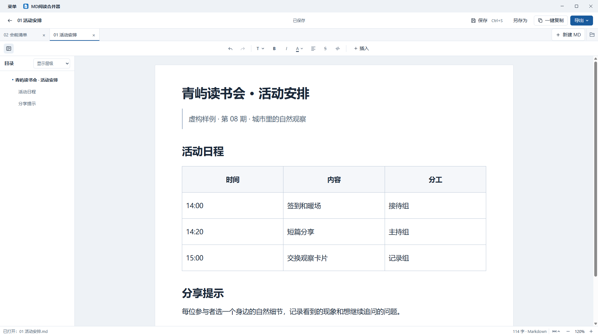
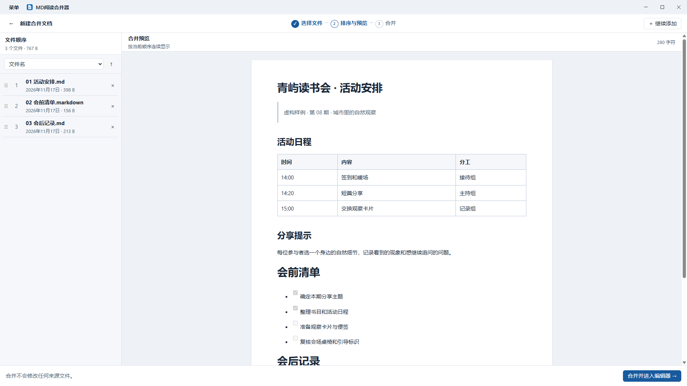

# MD阅读合并器

Windows 上的 Markdown 阅读、编辑与合并工具。可以同时打开多份 `.md` 或 `.markdown`，按顺序合成一份文档，并导出 Word、PDF 等格式。

**[打开软件官网](https://zhang19941016.github.io/md-reader-merger/)　·　[查看隐私说明](https://zhang19941016.github.io/md-reader-merger/privacy.html)**

## 下载和安装

**v2.3.1 已在 Microsoft Store 免费上架。** 打开 [Microsoft Store 下载页](https://apps.microsoft.com/detail/9P6BR4B44BN5)，点 **获取** 或 **安装**。

- 适用系统为 **Windows 10 / 11，64 位（x64）**。
- [GitHub Releases](https://github.com/zhang19941016/md-reader-merger/releases) 提供版本说明，Windows 安装请使用上面的商店链接。

## v2.3.1 更新

- 支持简体中文与英文，可在设置里切换语言、选择本机字体。
- 新增 TXT、Word（DOCX）导入，可作为副本编辑，保留原文件。
- 支持浮动查找和替换、打印预览，以及可选的自动保存。
- 本地文档可离线阅读、编辑和合并。需要时可在「帮助 → 检查更新」手动查询。

## 第一次使用

1. 在首页点 **打开文件**，选择一份或多份 Markdown。用标签在文件间切换，用目录或 `Ctrl+F` 查找内容。
2. 要把文件合成一篇，从首页进入合并流程，添加文件，拖动调整顺序并查看预览，再点 **合并并进入编辑器**。
3. 需要保留独立副本时，按 `Ctrl+Shift+S` 另存为新文件。用 **导出** 可另存为 Markdown、HTML、TXT、PDF 或 Word（DOCX）。

## 更新与反馈

Microsoft Store 版可通过商店更新。应用内的手动版本检查需要联网。

遇到问题，请发邮件至 [470554287@qq.com](mailto:470554287@qq.com)，说明软件版本、Windows 版本、操作步骤和报错。用可公开的样例复现即可。

